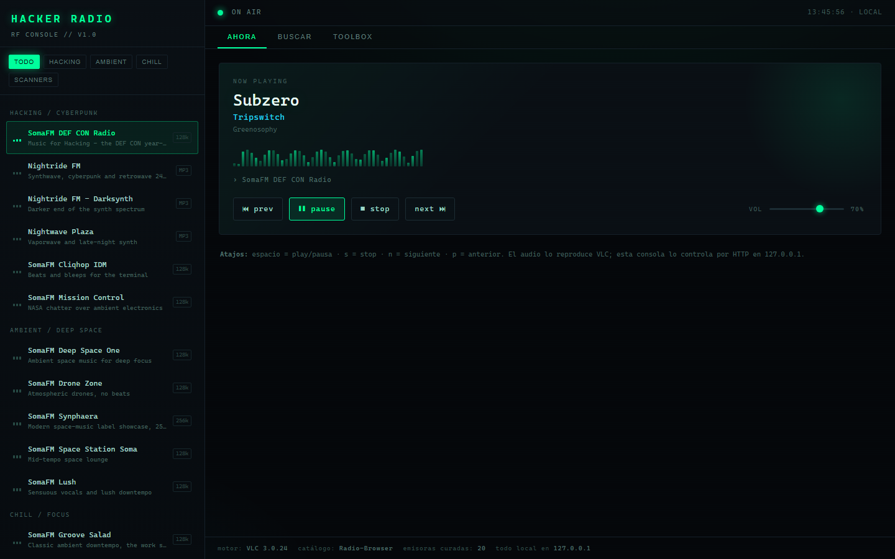

# Hacker Radio

[English](README.md) | **Español**

Consola de radio de una sola ventana para streams de hacking, ambient y
scanners. Veinte emisoras curadas y comprobadas a mano, más búsqueda sobre el
resto del catálogo de Radio-Browser.

VLC reproduce el audio y corre sin ninguna ventana. Un pequeño servidor en
Python lo controla por su interfaz HTTP, así que lo único que se ve es la
consola.




## Qué incluye

- 20 emisoras curadas: DEF CON Radio, Nightride FM, Nightwave Plaza, Deep Space
  One, Groove Salad, el scanner de la policía de San Francisco y algunas más.
- Búsqueda en vivo sobre más de 50 000 emisoras de Radio-Browser.
- Una pestaña de toolbox con enlaces de OSINT, pentesting y SDR.
- Una sola ventana. VLC queda invisible.
- Control por teclado con Espacio, S, N y P.
- Acceso directo en el escritorio y arranque automático opcional en Windows.

## Requisitos

Windows 10 u 11, Python 3.10 o superior, VLC 3.x y Chrome o Edge.
El servidor en Python también funciona en Linux si VLC está instalado.

## Instalación

```powershell
git clone https://github.com/AlexanderSharp/hacker-radio.git
cd hacker-radio
.\create-shortcuts.ps1
```

Doble clic en HACKER RADIO del escritorio. O arrancarlo a mano:

```powershell
.\start.ps1
```

## Controles

| Tecla o acción | Resultado |
|---|---|
| Espacio | reproducir o pausar |
| S | parar |
| N | siguiente emisora |
| P | anterior |
| Slider de volumen | volumen de VLC, de 0 a 100 |
| Pestaña Buscar | busca en Radio-Browser y reproduce al hacer clic |
| `.\stop.ps1` | para el servidor y el motor de audio |

Si cierras la ventana, la música sigue. Para callarla usa el botón de stop o
`stop.ps1`.

## Cómo funciona

```
ventana de la consola (Chrome en modo aplicación)
        |
        | HTTP
        v
server.py :8799  ->  VLC :8099  (--intf dummy, sin ventana)
```

VLC arranca como `vlc --intf dummy --extraintf=http --http-password=...`. Eso da
un reproductor sin interfaz y con la API de control completa. El PID se guarda
en `vlc.pid`, así que `stop.ps1` solo mata la instancia que arrancó él y nunca
un VLC que hayas abierto tú.

El cambio de emisora se verifica, no se supone. El comando `in_play` de VLC
puede devolver 200 y no hacer nada mientras carga el stream anterior. El
servidor lee el nombre del archivo que VLC está decodificando de verdad y
reintenta una vez si no coincide.

## Endpoints

| Ruta | Para qué |
|---|---|
| `GET /api/stations` | catálogo curado |
| `GET /api/play?slug=defcon` | reproducir una emisora del catálogo |
| `GET /api/playurl?u=URL` | reproducir cualquier URL |
| `GET /api/search?q=` | buscar en Radio-Browser |
| `GET /api/status` | estado, volumen y qué suena |
| `GET /api/volume?v=0..100` | cambiar volumen |
| `GET /api/next` / `GET /api/prev` | moverse por el catálogo |
| `GET /api/pause` / `GET /api/stop` | pausar o parar |

## Configuración

| Variable | Por defecto | Qué hace |
|---|---|---|
| `HACKER_RADIO_VLC` | autodetectado | ruta al binario de VLC |
| `APP_PORT` en `server.py` | 8799 | puerto de la consola |

El puerto de control de VLC, 8099, y su contraseña son constantes en
`server.py`. Los dos servidores escuchan solo en 127.0.0.1.

## Añadir emisoras

Añade una entrada a `STATIONS` en `server.py`:

```python
{"slug": "miemisora", "name": "Mi Emisora", "cat": "hacker",
 "desc": "A qué suena", "url": "https://ejemplo.com/stream.mp3",
 "codec": "MP3 128k", "site": "https://ejemplo.com/"},
```

Las categorías son `hacker`, `space`, `chill` y `radio`.

## Notas

SomaFM bloquea peticiones sin user agent de reproductor. VLC envía el suyo, así
que suena bien, y un curl pelado recibe un 403.

## Créditos

Emisoras de SomaFM, Nightride FM, Nightwave Plaza, Radio Paradise y Anon.FM.
Búsqueda de Radio-Browser. Audio de VLC.

## Licencia

MIT. Ver [LICENSE](LICENSE).
