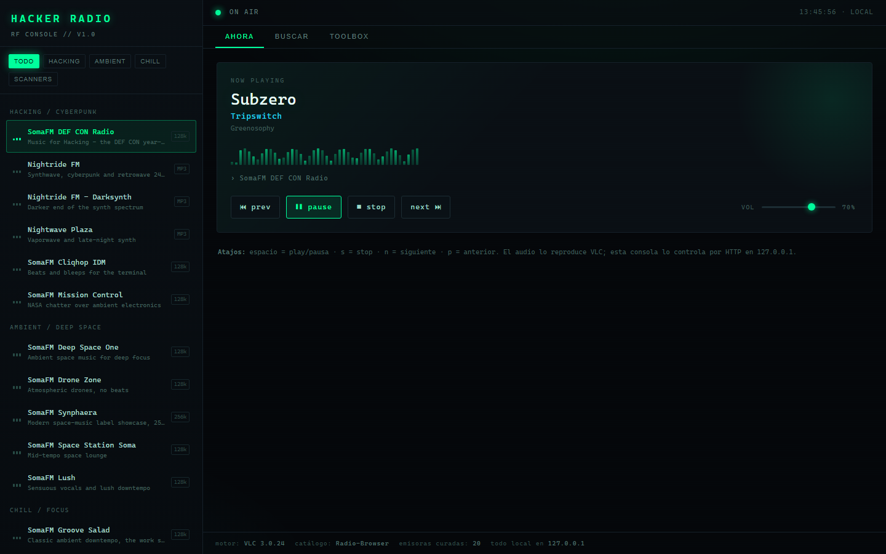

<p align="center">
  
</p>

<h1 align="center">Hacker Radio</h1>

<p align="center"><b>English</b> | <a href="README.es.md">Español</a></p>

A single window radio console for hacker, ambient and scanner streams. Twenty
stations are curated and checked by hand. Search covers the rest of the
Radio-Browser catalogue.

VLC handles the audio and runs with no window at all. A small Python server
drives it over its HTTP interface, so the only thing on screen is the console.




## Features

- 20 curated stations: DEF CON Radio, Nightride FM, Nightwave Plaza, Deep Space
  One, Groove Salad, SF Police Scanner and more.
- Live search over 50,000+ stations from Radio-Browser.
- A toolbox tab with OSINT, pentesting and SDR links.
- One window. VLC stays invisible.
- Keyboard control with Space, S, N and P.
- Desktop shortcut and optional autostart on Windows.

## Requirements

Windows 10 or 11, Python 3.10 or newer, VLC 3.x, and Chrome or Edge.
The Python server also runs on Linux when VLC is installed.

## Quick start

```powershell
git clone https://github.com/AlexanderSharp/hacker-radio.git
cd hacker-radio
.\create-shortcuts.ps1
```

Double click HACKER RADIO on the desktop. Or run it directly:

```powershell
.\start.ps1
```

## Controls

| Key or action | Result |
|---|---|
| Space | play or pause |
| S | stop |
| N | next station |
| P | previous station |
| Volume slider | VLC volume, 0 to 100 |
| Buscar tab | search Radio-Browser, click to play |
| `.\stop.ps1` | stop the server and the audio engine |

Closing the window leaves the music running. Use the stop button or `stop.ps1`
to silence it.

## How it works

```
console window (Chrome app mode)
        |
        | HTTP
        v
server.py :8799  ->  VLC :8099  (--intf dummy, no window)
```

VLC starts as `vlc --intf dummy --extraintf=http --http-password=...`. That gives
a player with no interface and a full control API. The PID is written to
`vlc.pid`, so `stop.ps1` only kills the instance it started and never a VLC you
opened yourself.

Switching stations is verified, not assumed. VLC's `in_play` command can return
200 and do nothing while it is still loading the previous stream. The server
reads back the filename VLC is actually decoding and retries once when it does
not match.

## Endpoints

| Route | Purpose |
|---|---|
| `GET /api/stations` | curated catalogue |
| `GET /api/play?slug=defcon` | play a catalogue station |
| `GET /api/playurl?u=URL` | play any stream URL |
| `GET /api/search?q=` | search Radio-Browser |
| `GET /api/status` | state, volume, now playing |
| `GET /api/volume?v=0..100` | set volume |
| `GET /api/next` / `GET /api/prev` | move through the catalogue |
| `GET /api/pause` / `GET /api/stop` | pause or stop |

## Configuration

| Variable | Default | Meaning |
|---|---|---|
| `HACKER_RADIO_VLC` | auto detected | path to the VLC binary |
| `APP_PORT` in `server.py` | 8799 | console port |

The VLC control port 8099 and its password are constants in `server.py`. Both
servers bind to 127.0.0.1 only.

## Adding stations

Add an entry to `STATIONS` in `server.py`:

```python
{"slug": "mystation", "name": "My Station", "cat": "hacker",
 "desc": "What it sounds like", "url": "https://example.com/stream.mp3",
 "codec": "MP3 128k", "site": "https://example.com/"},
```

Categories are `hacker`, `space`, `chill` and `radio`.

## Notes

SomaFM blocks requests without a player user agent. VLC sends its own, so
playback works and a bare curl gets a 403.

## Credits

Stations from SomaFM, Nightride FM, Nightwave Plaza, Radio Paradise and Anon.FM.
Search by Radio-Browser. Audio by VLC.

## License

MIT. See [LICENSE](LICENSE).
